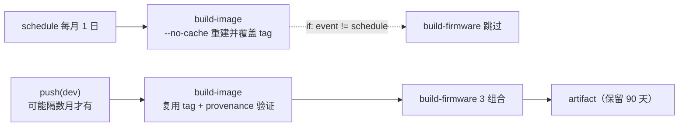
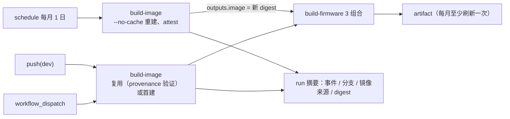

# Luckfox Pico CI 月度重建镜像后编译固件设计规格（Design Spec）

- **日期**：2026-11-03
- **状态**：已 Review
- **分支**：`pi/ci-schedule-firmware`（起点 `origin/dev` @ `c3ef27194`）
- **主题**：月度 `schedule` 重建 CI 镜像后同时编译固件，使最新固件 artifact 由最新镜像产出；写明不改代码时手动获取的方法
- **关联代码文件**：`.github/workflows/build-luckfox-pico-firmware.yml`
- **关联计划**：[`2026-11-03-luckfox-github-actions-schedule-firmware.md`](../plans/2026-11-03-luckfox-github-actions-schedule-firmware.md)
- **关联规格**：[`2026-07-17-luckfox-github-actions-ci-design.md`](2026-07-17-luckfox-github-actions-ci-design.md)（下称「CI spec」）。本规格修订其中「`schedule` 只重建镜像、跳过固件编译」这一决策（F3、§4.2、§4.3、§7 R8、§9 Q11），并更正 fork 下 schedule 不触发的顾虑

---

## 1. 背景与问题

CI spec 在 PR #3（提交 `6a048636f`，2026-07-23）加入了月度强制重建：

- `schedule`（`0 0 1 * *`）或手动 `force_rebuild` 时，`build-image` 以 `--no-cache` 重跑 apt，推送并覆盖同一个 tag（tag = `.cursor/Dockerfile` 内容 hash）；
- `build-firmware` 以 `if: github.event_name != 'schedule'` 跳过，月度成本约 3 分钟。

当时的目标只是吸收 apt 安全补丁，固件编译留给之后的 `push(dev)`（CI spec §4.2、§7 R8）。

### 1.1 实际现象

| run | 事件 | 时间（UTC） | 镜像 digest | 固件 |
| --- | --- | --- | --- | --- |
| [36806522884](https://github.com/yuangezhizao/luckfox-pico/actions/runs/36806522884) | schedule | 2026-10-01 | `sha256:6d5c7d16…` | 跳过 |
| [37313574328](https://github.com/yuangezhizao/luckfox-pico/actions/runs/37313574328) | push(dev)，PR #11 合并 | 2026-10-05 | `sha256:46162ca0…`（Dockerfile 注释变更，tag `60864362…` 首建） | 3 组合成功，artifact 2027-01-03 过期 |
| [41266391514](https://github.com/yuangezhizao/luckfox-pico/actions/runs/41266391514) | schedule | 2026-11-01 | `sha256:a470b047…`（同 tag `60864362…` 强制重建） | 跳过 |

2026-10-05 之后 `dev` 没有新提交。11-01 的镜像已经吸收了 10 月的 apt 更新，但没有任何固件由它编译：当时能下载的最新固件仍是 10-05 用上个月镜像编出来的。

### 1.2 问题归纳



1. **新镜像无人验证**：重建后的镜像要等下一次 `push(dev)` 才第一次用于编译。如果 apt 更新弄坏了编译，失败会出现在一个无关的代码提交上，排查方向会被带偏。
2. **最新固件不是最新镜像编的**：想要「最新环境编的固件」只能手动 `workflow_dispatch`，而 CI spec 没有写明这个方法。
3. **artifact 会过期**：GitHub 默认保留 artifact 90 天（[官方文档](https://docs.github.com/en/actions/how-tos/manage-workflow-runs/remove-workflow-artifacts)）。`dev` 长期没有提交时，最后一批固件过期后仓库里就没有可下载的固件了。

### 1.3 对 CI spec 中 fork 顾虑的更正

CI spec §4.3 与 §7 R8 担心本仓是 fork（`fork=true`），月度 `schedule` 可能不会自动触发。实际 2026-08-01、09-01、10-01、11-01 四次 schedule 都已触发并成功，`gh workflow list --all` 显示该 workflow 为 `active`。

另一条限制仍然有效：公开仓库 60 天没有活动时，GitHub 会自动停用 scheduled workflow（[官方文档](https://docs.github.com/en/actions/how-tos/manage-workflow-runs/disable-and-enable-workflows)）。如果 `dev` 一直没有新提交，schedule 会在最后一次提交约 60 天后被停用，处理见 §7。

---

## 2. 目标与非目标

**目标**

- G1：每次月度 schedule 重建镜像后，用这个新镜像编译 3 组合固件并上传 artifact。
- G2：新镜像在重建当月就经过完整固件编译验证。
- G3：run 摘要页写明本次用的镜像 digest 与触发事件，从固件 artifact 所在 run 即可追溯镜像。
- G4：写明不改代码、随时用最新镜像编固件的手动方法（§6）。
- G5：在 CI spec 与其 plan 中留下修订注记，从旧决策能找到本规格。

**非目标**

- 不改变 `push(dev)` 与 `workflow_dispatch` 的行为（G3 的摘要除外）。
- 不改变 provenance 生成与复用验证逻辑（CI spec §7 R10）。
- 不改变编译矩阵与 artifact 内容。
- 不发布 GitHub Release（§9 Q2）。
- 不做「编译通过后再晋升 tag」（§9 Q6）。

---

## 3. 方案比较

| 方案 | 做法 | 优点 | 缺点 |
| --- | --- | --- | --- |
| **A. schedule 也编译固件（采用）** | 删除 `build-firmware` 的 `if: github.event_name != 'schedule'` | 改动 1 行；满足 G1、G2；artifact 每月刷新 | 每月多用约 3 × 45–65 分钟 runner 时间（公开仓库标准 runner 免费，CI spec §9 Q7） |
| B. 保持现状，只写进文档 | 需要时在 `dev` 上手动 `workflow_dispatch`（§6） | 不改代码 | 不满足 G2；依赖人记得去点；镜像坏了要到下次编译才发现 |
| C. 新增开关 | 加 input 控制是否编译固件 | 灵活 | schedule 事件没有 input，只能靠额外 cron 或仓库变量区分，复杂度不值得 |

采用 A。B 的手动方法仍写入 §6，作为两次 schedule 之间的补充。

---

## 4. 目标行为



- schedule 运行在默认分支 `dev` 的最新提交上（[官方文档](https://docs.github.com/en/actions/reference/workflows-and-actions/workflow-syntax)），provenance 的 signer 与 source 都是 `refs/heads/dev`，与 `push(dev)` 相同，后续复用验证不受影响。
- `build-firmware` 通过 `needs.build-image.outputs.image`（`@digest`）使用刚构建的镜像，不经过 tag，不存在「编译时 tag 已被改指」的问题。
- `concurrency` 已按 `event_name` 分组（CI spec §4.7），schedule 的固件编译不会和 `push(dev)` 互相取消。
- 摘要中的「镜像来源」取三值之一：强制重建（`--no-cache`）、复用（provenance 验证通过）、首建（tag 不存在或 inspect 失败）。`github.event_name`、`github.ref_name` 经 `env` 传入脚本，不直接插入 `run`，避免分支名注入。

---

## 5. 需求

| ID | 需求 |
| --- | --- |
| F1 | `schedule` 事件下 `build-firmware` 3 组合全部运行，使用同一 run 中 `build-image` 输出的 digest。 |
| F2 | `push(dev)`、`workflow_dispatch` 的编译行为不变。 |
| F3 | `build-image` 向 `$GITHUB_STEP_SUMMARY` 写入触发事件、分支、镜像来源与完整镜像引用。 |
| F4 | workflow 中描述「schedule 只重建镜像、跳过固件」的注释同步更新。 |
| F5 | CI spec 与其 plan 的受影响段落保留原文，追加〔2026-11-03 修订〕注记并链接本规格。 |
| F6 | §6 的手动方法经实际 run 验证。 |

---

## 6. 手动用最新镜像编译固件

两次 schedule 之间，或想立即拿到最新镜像编的固件时，在 `dev` 上手动触发 workflow，**不勾选** `force_rebuild`：

```bash
gh workflow run build-luckfox-pico-firmware.yml -R yuangezhizao/luckfox-pico --ref dev -f force_rebuild=false
gh run list -R yuangezhizao/luckfox-pico -w build-luckfox-pico-firmware.yml -e workflow_dispatch -L 1
gh run watch <run-id> -R yuangezhizao/luckfox-pico
gh run download <run-id> -R yuangezhizao/luckfox-pico -D firmware/
```

网页操作：Actions → 「构建 Luckfox Pico 固件」→ Run workflow → 分支选 `dev` → 不勾选「强制重建 CI 镜像」→ Run workflow。

要点：

- `build-image` 走复用路径：tag 指向最近一次 schedule 重建的镜像，先通过 provenance 验证（signer/source=dev）再复用，然后编译 3 组合固件。
- 只有想在 schedule 之外额外吸收 apt 更新时才勾选 `force_rebuild`，且**只在 `dev` 上勾选**。在 feature 分支勾选会用该分支签名的镜像覆盖共享 tag，之后 `dev` 的复用验证会失败（CI spec §9 Q11）。
- 下载 artifact 需要登录 GitHub；artifact 保留 90 天。
- 实测（2026-11-03，run [41614992877](https://github.com/yuangezhizao/luckfox-pico/actions/runs/41614992877)）：复用 11-01 的 `sha256:a470b047…`，provenance 验证通过。两个 Pico Max 组合编译成功；Ultra W 分到小磁盘 runner，磁盘耗尽失败，与本方法无关（§7.1）。结果同时贴在 PR #12 评论区。

---

## 7. 风险

| ID | 风险 | 处理 |
| --- | --- | --- |
| R1 | 月度重建会立即覆盖 tag。如果新镜像导致固件编译失败，下一次 `push(dev)` 复用同一个坏镜像也会失败。 | 现状同样存在，只是发现得更晚。方案 A 让失败在 schedule 当天暴露。暂不做「编译通过后再晋升 tag」（§9 Q6）；遇到时修 Dockerfile（tag 随内容 hash 变化）或在 `dev` 上 `force_rebuild`。 |
| R2 | 公开仓库 60 天无活动会停用 schedule，之后既不重建镜像也不刷新固件。 | 接受。任意推送到 `dev` 都会重新计时；已被停用时在 Actions 页点 Enable workflow，或执行 `gh workflow enable build-luckfox-pico-firmware.yml -R yuangezhizao/luckfox-pico`。状态用 `gh workflow list --all` 查看，停用时为 `disabled_inactivity`。不加 keepalive（§9 Q4）。 |
| R3 | schedule 实际开始时间晚于 cron（11-01 那次 02:44 UTC 才开始）。 | 不影响正确性。 |
| R4 | 每月多 3 个约 1 小时的 job。 | 公开仓库标准 runner 免费，buildroot 下载包有 `actions/cache`。 |

| R5 | 标准 runner 的磁盘大小不固定，分到小磁盘时固件编译会耗尽磁盘。schedule 每月多跑一次 3 组合，遇到的次数随之增加。 | 本 PR 不修，只记录；临时处理与修复方法见 §7.1。 |

### 7.1 R5：小磁盘 runner 导致编译失败

**现象**：手动 run [41614992877](https://github.com/yuangezhizao/luckfox-pico/actions/runs/41614992877) 中，Ultra W · EMMC（job 125846640441）编译约 40 分钟后失败，runner 报 `System.IO.IOException: No space left on device`；两个 Pico Max 组合成功。

| job | runner 根分区 | 编译前空闲 | 峰值已用 | 结果 |
| --- | --- | --- | --- | --- |
| Ultra W · EMMC（本次） | 72G，`/dev/mapper/cow-root` | 7.8G | 71G 时耗尽（最后一次采样空闲 735M） | 失败 |
| Ultra W · EMMC（10-05，run 37313574328） | 145G，`/dev/root` | 81G | 76G（约需 12G） | 成功 |
| Max · SD_CARD、Max · SPI_NAND（本次） | 145G | 81G | 72G（约需 7G） | 成功 |

**根因**：编译前已用量都约 64G（runner 预装软件、CI 镜像与 SDK 检出），差别在于分到的磁盘总大小。GitHub 只承诺标准 Linux runner 有 14 GB SSD，实际大小因机器而异，以前恰好都分到 145G。CI spec §7 R1 已预判 Ultra W 风险最高，当时选择先不释放磁盘。在 72G 的机器上，Pico Max 也只剩约 0.8G 余量。报错来自 runner 写自身诊断日志，不是 `build.sh`。

**临时处理**：只重跑失败的 job，大概率会分到大磁盘：

```bash
gh run rerun <run-id> -R yuangezhizao/luckfox-pico --failed
```

**修复方法**（未实施）：`build-firmware` 使用 `container:`，所有步骤都在容器内执行，不能直接删除宿主机文件。可以用 `container.volumes` 把宿主机上用不到的预装目录挂进容器，在第一步清空。容器以 `--user 0` 运行，有删除权限；这些目录与工作目录同在根文件系统，释放的空间可直接用于编译。

```yaml
    container:
      # image / credentials / options 不变
      volumes:
        - /usr/local/lib/android:/host-free/android
        - /usr/share/dotnet:/host-free/dotnet
        - /opt/hostedtoolcache:/host-free/hostedtoolcache
    steps:
      - name: 🧹 释放宿主机磁盘（Android SDK / .NET / hostedtoolcache）
        run: |
          df -h /
          find /host-free -mindepth 2 -maxdepth 2 -exec rm -rf {} +
          df -h /
```

- 挂载点本身不能删除，所以只删其下内容（`-mindepth 2`）；宿主机上不存在的路径会被 Docker 建成空目录，不会报错。
- 第三方在另一种镜像上实测，这三个目录合计约 18G（[latchkey.dev](https://latchkey.dev/learn/failures/free-disk-space-on-github-actions-runners)）。按这个量估算，72G 的机器可用空间能从 7.8G 增至约 26G，超过 Ultra W 所需的约 12G。实际释放量需在本仓 runner 上用前后两次 `df` 确认，`cow-root` 布局的机器尤其要确认。
- 验证方法：在修复分支 `workflow_dispatch` 且不勾 `force_rebuild`（只读 tag，不覆盖共享镜像，见 §6），查看清理前后的 `df`。分到哪种 runner 无法控制，可能要跑多次才能遇到 72G 的机器。
- 被否决的替代：去掉 `container:`，先在宿主机上释放空间再 `docker run`。这样最干净，但要改 job 结构和镜像凭据的拉取方式，改动面大。

---

## 8. 验证策略

- **静态检查**：`actionlint`（含 shellcheck）对改后的 workflow 无报错；`build-firmware` 不再有 `if`。
- **摘要片段**：在本地用假变量执行写摘要的 shell 片段，输出为合法 Markdown 表格。
- **在本分支执行新代码**：在本分支 `workflow_dispatch` 且不勾 `force_rebuild`，build-image 走复用路径（只读 tag、不推送），执行新增的摘要代码；固件 job 与 `dev` 上的手动 run 相同，取消即可。
- **不在本分支模拟 schedule**：在 feature 分支 `force_rebuild` 会用该分支签名的镜像覆盖共享 tag（§6），不这样做。push 与 schedule 走的是同一条 `build-firmware` 路径，差别只在已删除的 `if`。
- **合并后**：合并后 `dev` 的 push run 与 2026-12-01 的 schedule 照常自动运行，摘要与固件结果在 Actions 中可查，不另设收尾步骤。
- **手动方法**：§6 的命令已实际执行，镜像部分的证据在 plan，固件结果见 PR #12 评论。

---

## 9. QA 记录

| ID | 问题 | 用户选择 | 备注 |
| --- | --- | --- | --- |
| Q1 | schedule 是否编译固件 | ✅ 方案 A：删除 `if` 门禁 | 方案 B 的手动方法保留在 §6，作为两次 schedule 之间的补充；方案比较见 §3 |
| Q2 | 是否顺带发布滚动 Release（下载免登录、不过期） | ✅ 不在本 PR 做 | 以后另议；artifact 每月刷新已解决「无固件可下载」 |
| Q3 | 是否在 run 摘要写入镜像 digest 与触发事件 | ✅ 写入 | 从固件所在 run 追溯镜像，见 §4、F3 |
| Q4 | 60 天无活动停用 schedule：接受并文档化，还是加 keepalive | ✅ 接受并文档化 | keepalive 要么定期产生提交噪音，要么引入第三方 action；恢复方法见 §7 R2 |
| Q5 | CI spec / plan 的旧决策：原地改写还是加注记 | ✅ 保留原文、加〔2026-11-03 修订〕注记 | 与 PR #11 的做法一致，旧文档可追溯 |
| Q6 | 是否做「编译通过后再晋升 tag」 | ✅ 不做，只记为风险 | 需临时 tag 与晋升步骤，复杂度高；见 §7 R1 |
| Q7 | 小磁盘 runner 导致 Ultra W 失败，是否在本 PR 修复 | ✅ 暂不修复，记录现象、根因与修复方法 | 与本 PR 主题无关，是 CI spec §7 R1 的旧风险；见 §7.1 |
